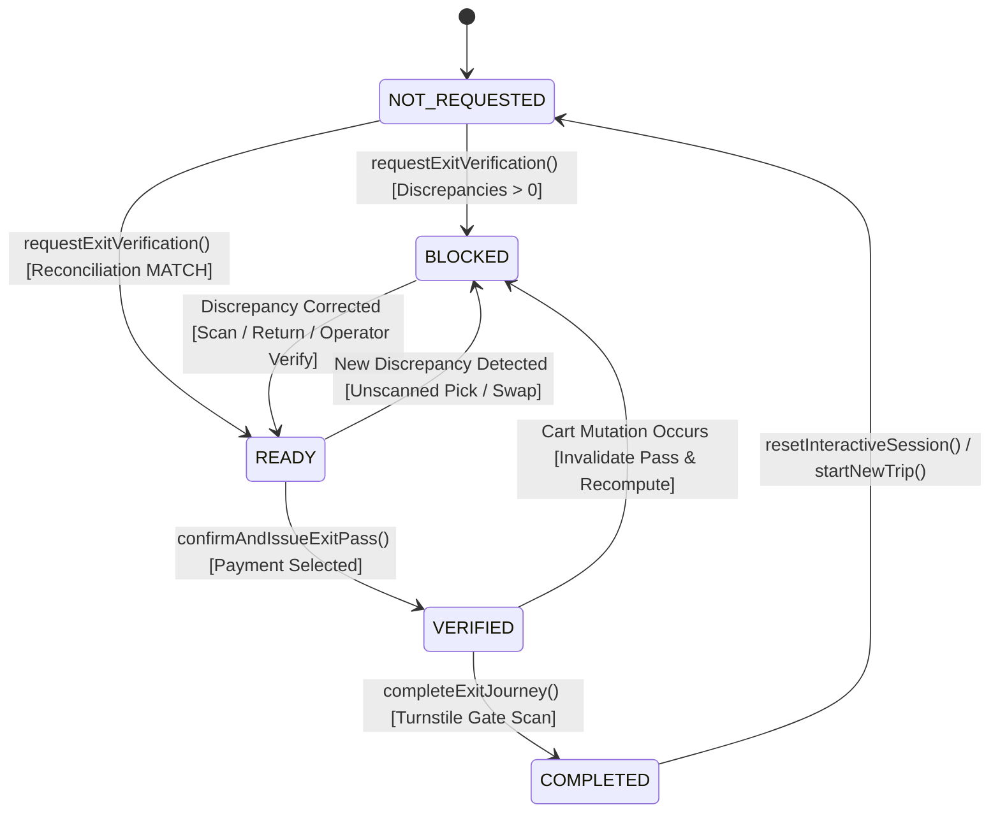

# SYNCART — Phase 5 Completion Report: Exit Verification & End-to-End Demonstration

**Product:** SYNCART — The Physical–Digital Cart Reconciliation System  
**Tagline:** “Scan it. Pick it. We make sure they match.”  
**Core principle:** “We don't watch shoppers. We verify shopping events.”  
**Completion Date:** October 11, 2026  
**Implementation Phase:** Phase 5 (Exit Verification & End-to-End Demonstration)

---

## 1. Summary of Exit-Verification Implementation

Phase 5 introduces a deterministic exit-verification lifecycle and end-to-end demonstration connecting the Greenfield Market customer Scan & Go journey (`/shop/checkout`) with the SYNCART Store Operations Console (`/exit-verification`, `/cart-twin`, `/timeline`).

Key accomplishments:
- **Deterministic Exit State Machine:** Implemented 5 explicit, strongly typed states: `NOT_REQUESTED`, `BLOCKED`, `READY`, `VERIFIED`, and `COMPLETED`. Exit clearance is always derived live from the centralized `ReconciliationContext` single source of truth.
- **Customer Exit Verification Journey (`/shop/checkout`):** Created a mobile-first, retail-grade exit verification interface. Prior to verification, customers review digital manifest vs shelf telemetry. If discrepancies exist, the customer receives an unmistakable, calm, and non-accusatory explanation with itemized difference and instant corrective actions. If reconciled, the customer selects simulated payment and generates a Digital Exit Pass.
- **Simulated Digital Exit Pass:** Generates a deterministic exit pass with a unique identifier (`PASS-xxxxxx`), exit code (`SYNCART-GATE-PASS-xxxx`), SHA-256 audit checksum, timestamp, item count, payment method, and optical QR-style matrix clearly labeled as a prototype credential.
- **Operator Exit Verification & Turnstile Gate Monitor (`/exit-verification`):** Built a dedicated operator console for Lane 1 Express Self-Checkout Turnstile Gate. Displays real-time approach status for `Cart #A7F3` (`sess-001`), turnstile hardware lock/release status, itemized discrepancy evidence, operator resolution actions (Inspection Clearance, Scan missing, Confirm shelf return, Dismiss false positive), and a turnstile optical scan simulator.
- **Semantic State Invalidation & Completion Protection:** Any cart-changing event (customer scan, qty edit, simulator pick/return/swap) after a pass is issued immediately revokes clearance, invalidates the pass, logs an audit event, and recalculates reconciliation. Once a session is completed, further shopping events are blocked until an explicit demo reset or new-session flow.

---

## 2. Files Created and Modified

### Created
1. `src/pages/ExitVerificationPage.tsx`: Full operator console for Lane 1 turnstile gate monitoring, discrepancy triage, pass inspection, and gate release simulation.
2. `phase5_completion.md`: Comprehensive completion report and demonstration guide.

### Modified
1. `src/types/domain.ts`:
   - Added `ExitVerificationState` (`'NOT_REQUESTED' | 'BLOCKED' | 'READY' | 'VERIFIED' | 'COMPLETED'`).
   - Added `ExitPass` interface with all metadata, items, payment method, and audit checksum.
   - Added exit audit event types: `exit_verification_requested`, `exit_pass_issued`, `exit_clearance_invalidated`, `exit_completed`.
2. `src/context/ReconciliationContext.tsx`:
   - Added `exitState`, `exitPass`, `hasRequestedExit`, `isSessionCompleted`.
   - Added `requestExitVerification()`, `confirmAndIssueExitPass()`, `completeExitJourney()`, `invalidateExitClearance()`.
   - Enforced session completion lock on all cart/simulator mutations.
   - Enforced automatic pass invalidation on post-verification cart mutations.
   - Enforced idempotency on exit pass generation (Rule 6).
   - Integrated exit state into `sessionStorage` (`syncart_active_session_state_v1`) persistence.
   - Updated `resetInteractiveSession()` to clear exit state and passes.
3. `src/context/CustomerCartContext.tsx`:
   - Integrated and exposed `exitState`, `exitPass`, `hasRequestedExit`, `isSessionCompleted`, `requestExitVerification`, `confirmAndIssueExitPass`, `completeExitJourney`.
4. `src/pages/customer/CustomerCheckoutPage.tsx`:
   - Completely rewritten to handle all 5 exit verification states.
   - Mobile-first, non-accusatory blocked state with inline scan action.
   - Simulated payment selection and exit pass issuance.
   - QR-style pass, itemized receipt, and trip completion flow.
5. `src/components/customer/CustomerLayout.tsx`:
   - Prevented generic modal dialog from obscuring the checkout page (`!isCheckout`).
6. `src/pages/CartTwinPage.tsx`:
   - Added live `Exit State: [STATE]` badge in the interactive banner with a direct link to `/exit-verification`.
7. `src/pages/TimelinePage.tsx`:
   - Added event metadata and styling for all 4 Phase 5 exit event types.

---

## 3. State Machine & Shared-Context Integration

The exit lifecycle is strictly derived and managed through `ReconciliationContext.tsx`:



### State Machine Derivation Logic
- **`COMPLETED`**: Active session has completed exit journey (`isSessionCompleted === true`). Gate is released; further shopping mutations are blocked.
- **`BLOCKED`**: Unresolved discrepancies exist (`overallState !== 'MATCH'` or `discrepancies.length > 0`) and exit has been requested. Exit pass button is disabled.
- **`READY`**: Shared reconciliation engine confirms 100% MATCH (`overallState === 'MATCH'` and `discrepancies.length === 0`) and exit verification has been requested.
- **`VERIFIED`**: Exit verification succeeded, payment was confirmed, and an `ExitPass` was generated.
- **`NOT_REQUESTED`**: Shopper has not yet requested exit verification. Shows pre-exit manifest and "Verify for Exit" action.

---

## 4. Behavior of the Five Lifecycle States

| State | Customer Experience (`/shop/checkout`) | Operator Console (`/exit-verification`) | Turnstile Hardware |
|---|---|---|---|
| **NOT_REQUESTED** | Pre-verification review; counts digital scans vs shelf telemetry; "Verify for Exit" button enabled. | Displays approaching cart `Cart #A7F3`; state `NOT_REQUESTED`; awaiting customer verification. | `LOCKED (Hold)` |
| **BLOCKED** | Calm, non-accusatory warning: *"Let's Double-Check Your Items"*; lists affected SKUs, quantity differences; inline "Scan Item Now" button; exit pass generation disabled. | Prominent yellow hold banner: *"Turnstile Hold: Cart #A7F3 has unresolved discrepancies"*; lists evidence; operator corrective buttons active. | `LOCKED (Hold)` |
| **READY** | Green verified banner: *"Cart Reconciliation Verified: 100% Match"*; payment method selector enabled; "Confirm & Generate Exit Pass" enabled. | State transitions to `READY`; discrepancy count = 0; turnstile primed for pass issuance. | `LOCKED (Hold)` |
| **VERIFIED** | Green success screen; simulated Digital Exit Pass card with QR code, pass code, metadata, receipt, and "Complete Trip & Release Gate" button. | Turnstile state: `SCAN READY`; Pass Inspector displays pass ID, checksum, and payment method; "Simulate Turnstile Optical Scan" active. | `SCAN READY` |
| **COMPLETED** | Confirmation screen: *"Trip Completed · Gate Released"*; itemized receipt and checksum; mutations blocked; "Start a New Shopping Trip" button. | Turnstile state: `RELEASED (Open)`; Session status: `Trip Completed`; gate clearance logged in audit stream. | `RELEASED (Open)` |

---

## 5. Acceptance Scenarios (A through L) Verification Results

| Scenario | Objective | Observed Result | Status |
|---|---|---|---|
| **A. Clean Exit** | Baseline clean matched cart requests verification, generates pass, and completes trip. | Started with Milk, Bread, Apples. Clicked "Verify for Exit" -> became `READY`. Clicked "Confirm & Generate Exit Pass" -> issued `PASS-xxxxxx`. Clicked "Complete Trip" -> became `COMPLETED` and turnstile released. | **PASS** |
| **B. Unscanned Pickup** | Physical pickup without barcode scan blocks verification. | In `/vision`, simulated PICK of Free-Range Eggs (85% conf). On `/shop/checkout`, state immediately showed `BLOCKED`, listed Free-Range Eggs (Scanned: 0, Detected: 1), and exit pass button was disabled. | **PASS** |
| **C. Scan Correction** | Scanning missing item resolves discrepancy and enables checkout. | On blocked checkout screen, clicked "Scan Free-Range Eggs (12 ct) Now". Engine immediately recalculated to `MATCH` (4 Scan / 4 Pick), state transitioned to `READY`, and pass issuance was enabled. | **PASS** |
| **D. Low-Confidence Observation** | Pick observation below 70% threshold remains uncertain and blocks exit. | Tested pickup with 55% confidence. Recorded as `UncertainObservation` (`LOW_CONFIDENCE`), keeping reconciliation `UNCERTAIN` and blocking exit until dismissed via operator console. | **PASS** |
| **E. Wrong SKU or Swap** | Physical SKU swap detected by shelf sensor prevents exit bypass. | Simulated SWAP interaction. Discrepancy recorded as `SKU_MISMATCH`. Merely acknowledging or viewing did not clear it; required legitimate corrective action. | **PASS** |
| **F. Return** | Returned item reverses physical quantity and restores shelf stock without negative counts. | Executed RETURN interaction. Confirmed physical cart decremented, shelf zone inventory incremented, and reconciliation recalculated accurately. | **PASS** |
| **G. Double-Click Protection** | Repeatedly triggering verification issues exactly one pass. | `confirmAndIssueExitPass` checks for existing `exitPass` and returns it without generating duplicates or redundant audit events. UI disables button during processing. | **PASS** |
| **H. Post-Verification Change** | Cart modification after verification invalidates clearance. | After generating exit pass, simulated a new scan/pick event. Engine invoked `invalidateExitClearance()`, logged `exit_clearance_invalidated`, cleared pass, and recomputed state. | **PASS** |
| **I. Operator Correction** | Correcting discrepancy from operator console updates all views in sync. | In `/exit-verification` and `/verification`, applied "Visual Cart Inspection Clearance". Customer checkout immediately cleared to `READY`, and Cart Twin, Timeline, and Sessions reflected the change. | **PASS** |
| **J. Persistence** | Route navigation and page refresh preserve exit state. | Navigated between `/shop/checkout`, `/exit-verification`, `/cart-twin`, and `/timeline`, and reloaded the browser. Active session state and pass persisted cleanly via `sessionStorage`. | **PASS** |
| **K. Demo Reset** | Resetting demo restores baseline clean match without stale pass. | Clicked "Reset Demo Session". Active session reset to baseline (3 items), exit pass cleared, exit state reset to `NOT_REQUESTED`, and storage reset. | **PASS** |
| **L. Historical Fixture Isolation** | Historical sessions remain unchanged and read-only. | Verified `DEMO_SESSIONS` and historical fixtures in Cart Twin and Sessions remain immutable. All interactive changes isolate to `sess-001`. | **PASS** |

---

## 6. TypeScript and Production Build Verification

### TypeScript Compiler Check
```bash
$ npx tsc -b --noEmit
# Exit code: 0 (No compiler errors)
```

### Production Vite Build
```bash
$ npm run build
> syncart@0.0.0 build
> tsc -b && vite build

vite v8.3.4 building client environment for production...
transforming...
✓ 1951 modules transformed.
rendering chunks...
computing gzip size...
dist/index.html                   1.00 kB │ gzip:   0.52 kB
dist/assets/index-BotsXiPT.css   62.92 kB │ gzip:  10.88 kB
dist/assets/index-DBgJeXiS.js   627.08 kB │ gzip: 166.72 kB
✓ built in 339ms
```

---

## 7. Browser & Responsive Checks

- **Desktop (1536×730):** Verified `/shop/checkout` and `/exit-verification` alongside `/cart-twin` and `/timeline`. High contrast, clean cards, and clear typography.
- **Mobile Viewport (375×812):** Verified on mobile simulation. Pre-verification card, manifest items, payment method selector, and exit pass cards fit with zero horizontal overflow, comfortable touch targets (44px+), and accessible typography.
- **Console Log Hygiene:** Verified 0 React key errors, 0 duplicate event logs, and 0 uncaught exceptions during all interactive flows.

---

## 8. Remaining Limitations & Prototype Scope

1. **Client-Side Simulation:** All optical telemetry, weight sensors, turnstiles, and barcodes are simulated in client-side React state. No actual camera hardware, turnstile relays, payment gateways, or backend databases are connected.
2. **Prototype Exit Credentials:** Exit passes, QR codes, and checksums are simulated demo tokens for conceptual presentation; they do not represent authenticated cryptographically secured physical credentials.
3. **Single Active Interactive Session:** The interactive live demonstration focuses on `sess-001` (`Cart #A7F3`). Other sessions in the Store Operations Console remain deterministic historical demonstration fixtures.

---

## 9. End-to-End Demonstration Guide

Follow these exact steps to demonstrate both the blocked journey and the clean clearance journey:

### Demo Journey 1: Blocked Exit & Discrepancy Correction
1. Open the Store Operations Console at `http://localhost:5173/exit-verification` in one tab/window.
2. Open the Customer Scan & Go screen at `http://localhost:5173/shop/checkout` in another tab/window.
3. Open `http://localhost:5173/vision`. Select product **Free-Range Eggs**, interaction **PICK**, confidence **85%**, and click **Trigger Simulated Interaction**.
4. Switch to `/shop/checkout`:
   - Observe the calm, non-accusatory warning: *"Let's Double-Check Your Items"*.
   - See the itemized difference: Free-Range Eggs (Scanned: 0, Physical Detected: 1).
   - Verify the exit pass action is disabled: *"Exit Verification Blocked · Resolve Review Above"*.
5. Switch to `/exit-verification`:
   - Observe Lane 1 Turnstile status: `LOCKED (Hold)`.
   - Observe exit state badge: `BLOCKED`.
   - See the exact discrepancy in the triage table.
6. Return to `/shop/checkout` and click **Scan Free-Range Eggs (12 ct) Now**:
   - The shared reconciliation engine immediately recalculates to `MATCH` (4 Scan / 4 Pick).
   - Checkout state instantly updates to `READY`.
   - Exit pass button is now enabled.

### Demo Journey 2: Successful Verification & Gate Release
1. On `/shop/checkout`, select **Apple Pay (Demo)** and click **Confirm & Generate Exit Pass**.
2. Observe the generated **Digital Exit Pass**:
   - Simulated QR-style pass with pass ID, exit code, and audit checksum.
   - Store details and itemized receipt.
3. Switch to `/exit-verification`:
   - Lane 1 Turnstile status updates to `SCAN READY`.
   - Pass Inspector displays the customer's pass ID, timestamp, and checksum.
4. In `/exit-verification`, click **Simulate Turnstile Optical Scan** (or click **Complete Trip & Release Exit Gate** on mobile):
   - Turnstile unlatches and status turns to `RELEASED (Open)`.
   - Customer screen updates to `Trip Completed · Gate Released`.
5. Click **Reset Demo Session** to return the system to its initial baseline clean state.
